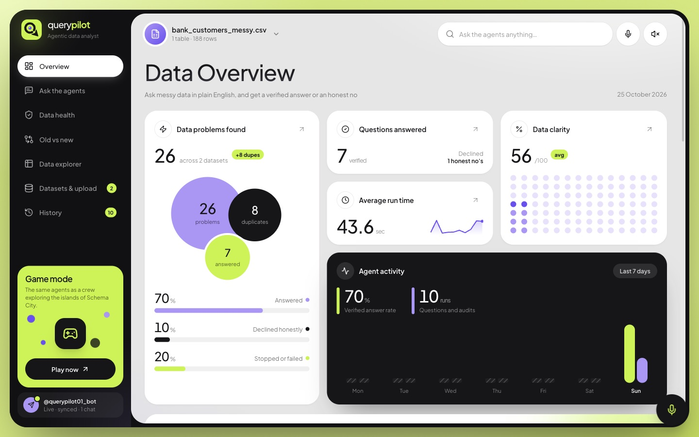
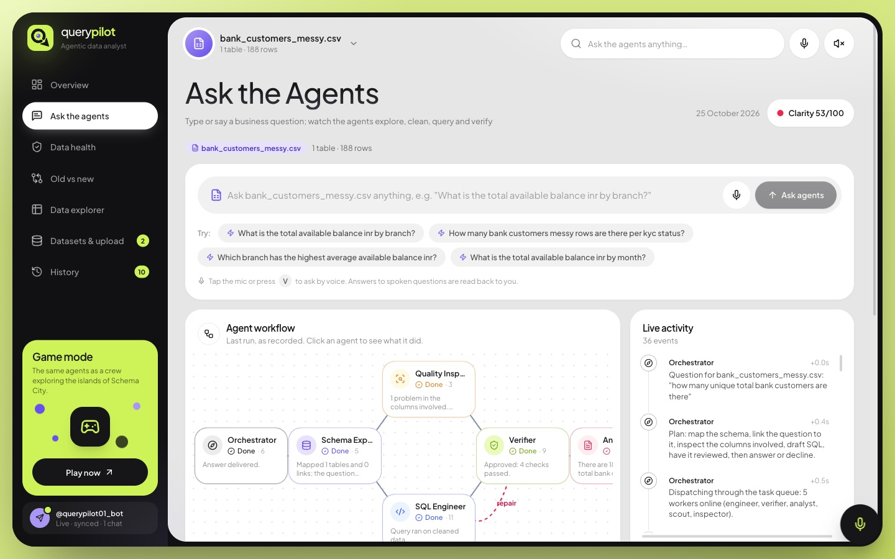
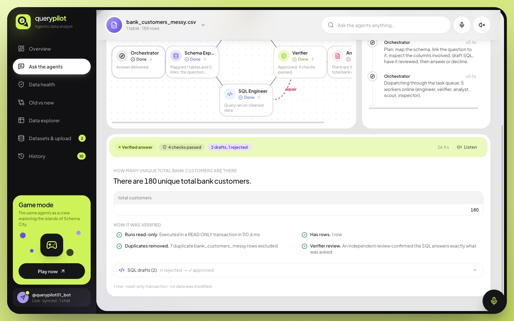
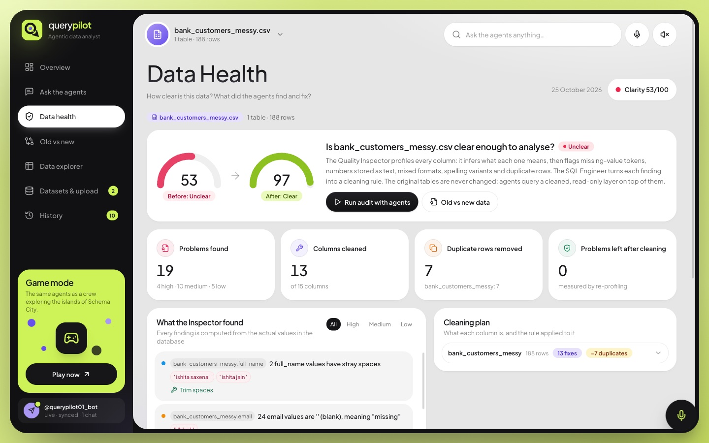
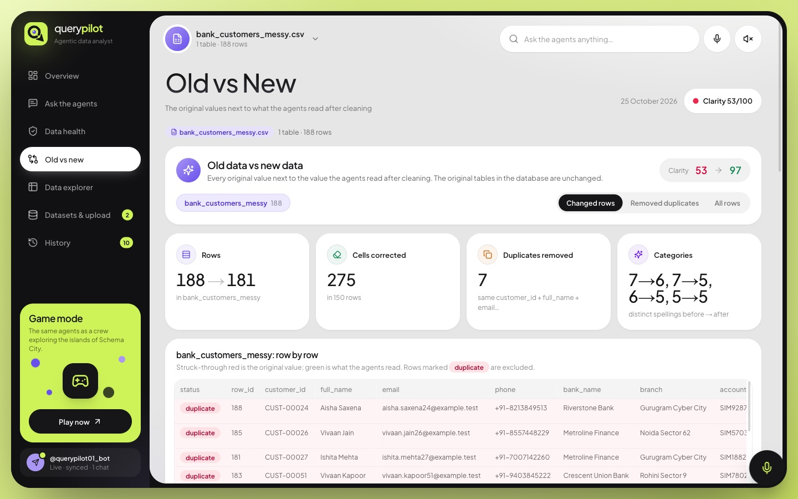
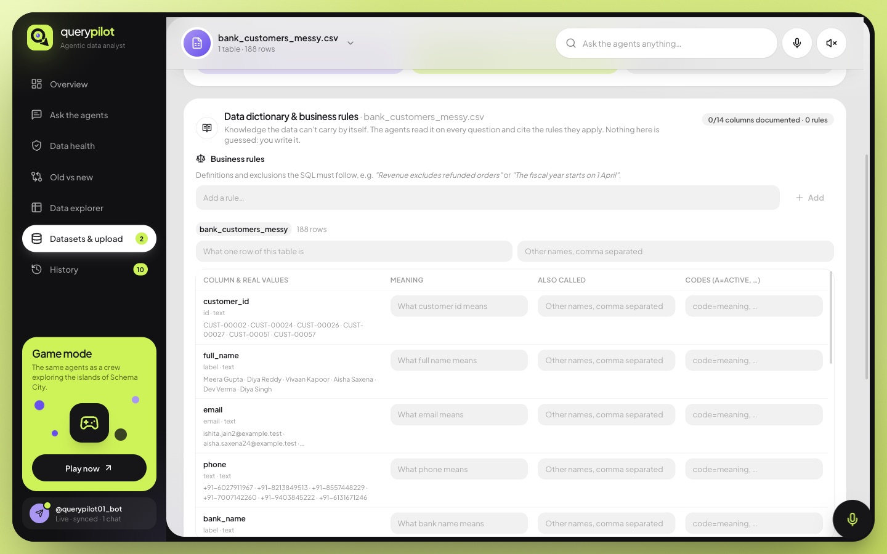
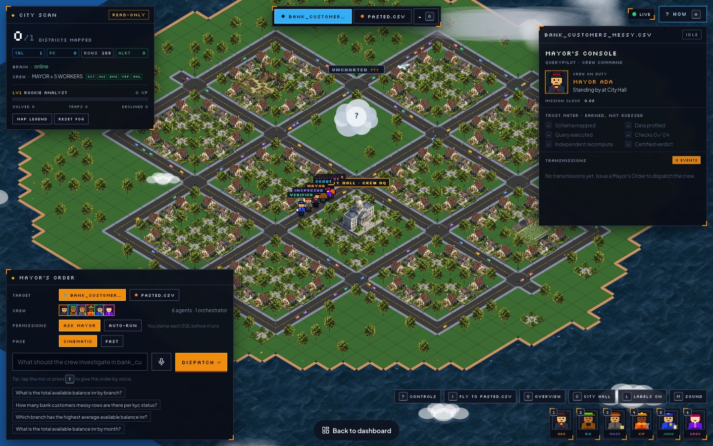

# QueryPilot

**Ask a messy database a question in plain English. Get a verified answer, or an honest "the data can't tell you that".**

QueryPilot is an AI data analyst made of six small agents. You upload a messy CSV (amounts stored as text, mixed date formats, the same city spelled three ways, duplicate rows) and ask questions about it. The agents explore the data, clean what they read, write **read-only** SQL, check the result, and only then answer. If the data cannot support an answer, they say so instead of guessing.

You can use it in three ways, all connected live:

| Surface | What it is |
|---|---|
| **Dashboard** | A clean analyst workspace: ask, audit, compare, explore |
| **Game (Schema City)** | The same agents as a pixel-art crew exploring islands built from your data |
| **Telegram bot** | Ask questions and watch runs from your phone |



---

## The six agents

| Agent | Game name | Job |
|---|---|---|
| 🧭 Orchestrator | Ada | Plans the run and hands out tasks |
| 🗺 Schema Explorer | Rio | Maps tables, columns and links between tables |
| 🔎 Quality Inspector | Moss | Finds dirty values: text numbers, mixed dates, spelling variants, duplicates |
| 🛠 SQL Engineer | Kip | Writes read-only SQL on a cleaned view of the data |
| 🛡 Verifier | Juno | Challenges every result and sends bad drafts back for repair |
| 📝 Analyst | Wren | Answers from the verified rows only, or declines |

```
question ─► Orchestrator ─► Schema Explorer ─► Quality Inspector ─► SQL Engineer ─► Verifier ─► Analyst ─► answer
                                                                        ▲               │
                                                                        └── repair ─────┘   (or an honest "no")
```

Your original data is **never changed**. Cleaning happens in a read-only layer on top of it, and every query runs in a `READ ONLY` transaction.

---

## The dashboard

### Ask the agents
Type or **say** a question (mic button, or press `V`). Watch each agent work in the workflow graph and the live activity feed.



Every answer shows **how it was verified**: which checks passed, how many SQL drafts were rejected, and the final SQL.



### Data health
A clarity score before and after cleaning, every problem the Inspector found, and the cleaning rule applied to each column.



### Old vs new
Every original value next to what the agents actually read after cleaning, row by row, including removed duplicates.



### Datasets, data dictionary and business rules
Upload a CSV (drag and drop or paste). Then tell the agents what the data can't say by itself: what columns mean, other names for them, what codes stand for (`R = refunded`), and **business rules** such as *"Revenue excludes refunded orders"*. The agents apply these rules and the Verifier checks each one.



Other pages: **Overview** (totals and activity), **Data explorer** (browse raw or cleaned rows), **History** (replay any past run).

---

## The game: Schema City

The same agents, as a crew of detectives. Each uploaded dataset becomes an island: **every building is a table and every house is a row of your real data.**


Give a **Mayor's Order** (type it or press `T` to speak). The crew walks the city, inspects the buildings, writes SQL and brings back a verdict. Fog lifts as districts get mapped, and you earn XP for solved cases.



| Key | Action |
|---|---|
| `Enter` | Focus the order box / dispatch |
| `T` | Give an order by voice |
| `I` / `O` | Fly to the next island / overview |
| `W A S D` or arrows | Pan the camera |
| Click a building | Open the table's dossier |
| `Y` / `N` | Approve or deny an SQL permit (when "Ask Mayor" is on) |
| `X` | Halt the mission |
| `H` | How it works |

---

## Telegram bot

Everything runs live in Telegram too. Runs started from the dashboard or the game appear in the chat as cards that update in real time.

- Type any question, or use the buttons: **Ask a question, Data health, Before vs after, Browse data, Datasets, Recent runs**
- Send a `.csv` file to upload and audit it
- `/rules` and `/rule <text>` to manage business rules

---

## Run it locally

You need [Bun](https://bun.sh) (or Node 20+), a Postgres database and an API key for the AI agents.

```bash
bun install
cp .env.example .env.local     # then fill in the values below
bun run db:migrate             # creates the tables QueryPilot needs
bun run dev                    # http://localhost:3000
```

`.env.local`:

| Variable | Required | What it is |
|---|---|---|
| `DATABASE_URL` | yes | Postgres connection string (owner role) |
| AI agents' API key | yes | See `.env.example` |
| `DATABASE_URL_READONLY` | no | A read-only login for agent queries (see `db/readonly_role.sql`) |
| `TELEGRAM_BOT_TOKEN` | no | Enables the Telegram bot |
| `TELEGRAM_BOT_USERNAME` | no | The bot's @username |
| `QP_WORKERS` | no | Set to `external` to run agents in separate worker processes (`bun run worker`) |

Then open the dashboard, upload a CSV under **Datasets & upload**, and ask a question.

---

## How it's built

- **Next.js 16** (App Router, React 19) and **Tailwind CSS** for the dashboard and the game
- **Postgres** with **Prisma** for the run log, uploads and the agent task queue; `LISTEN/NOTIFY` pushes every agent event live to the dashboard, the game and Telegram
- **AI agents** for the SQL Engineer, Verifier and Analyst; profiling, cleaning and the checks are deterministic code
- Agents run as **workers on a task queue**, so they can run inside the web server or on separate machines

```
src/
  app/                 pages and API routes
  components/app/      the dashboard
  components/quest/    the Schema City game
  server/agent/        orchestrator, workers, AI client
  server/engine/       profiling, cleaning layer, checks, agent prompts
  server/datasets/     uploads, data dictionary, business rules
  server/telegram/     the Telegram bot
```
